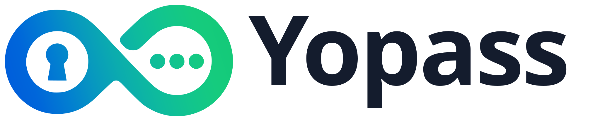

# Bode Secret Share

**Secret Share** is Bode's encrypted, single-use sharing application, hosted at
**https://secret.bode.one**. The design follows https://bode.one.

## Bode Defaults

- The website is English-only. Browser language and previously saved language preferences are ignored; there is no language selector.
- Every new text or file link can be retrieved exactly once. The API rejects reusable secrets, even if an old client sends `one_time: false`.
- Automatic deletion choices are **Three Hours**, **One Day**, and **One Week**. The default is three hours (`10800` seconds). Custom expiration is not supported in this distribution.
- The website offers a selector for 1 to 10 independent links per submission. Each has its own encrypted record and randomly generated decryption key. Opening one does not consume any other link.
- Results always start with one-click links. Each link has a **Share decryption key separately** button to show a short link and a separate key, and a **Use one-click link** button to switch back. This only changes presentation; it never creates, consumes or changes the stored secret. Receipts stay attached to their original links.
- Keys are generated locally in the browser, never chosen by the sender or sent to the server. They live in the URL fragment or can be shared separately. The Go CLI also generates keys automatically when creating secrets.
- If a batch fails partway through, already-created links remain visible. Links and keys are not persisted by the website.

Single-use means one retrieval **from the server**. A recipient can still copy plaintext or save a downloaded file; no sharing service can prevent that after decryption.

## Go Deployment

For Coolify with Memcached, use [docker-compose.coolify.yml](docker-compose.coolify.yml)
and the [Coolify deployment guide](docs/coolify.md). This production-oriented
variant uses Coolify's HTTPS proxy, an isolated private Memcached network
and no published host ports. The commands below are for a standalone/local host.

The main [Dockerfile](Dockerfile) builds the **Go server and Go CLI**, not Rust.
The runtime container needs neither Node.js nor Rust. The server serves both the
API and prebuilt website. The website still needs browser JavaScript for local
OpenPGP encryption; moving that encryption to Go on the server would reveal keys
and plaintext to the server. Rewriting the browser in Go/WASM is possible but
unnecessary and is not part of this change.

```sh
docker compose -f deploy/docker-compose/insecure/docker-compose.yml up --build -d
```

The Compose stack uses the Go server's Memcached backend. Memcached
is only accessible inside the Compose network, with no public database port.
It uses a 64 MB cache within a 128 MB container limit by default, rather than
the previous Dragonfly configuration's 512 MB data limit. These limits are not
idle RAM usage. No persistent storage is configured; restarting Memcached loses
outstanding links and receipts. New writes fail when the cache is full rather
than evicting existing records. UDP is disabled.

The service listens on `127.0.0.1:1337`. Configure your existing HTTPS reverse
proxy for `secret.bode.one` to forward to this address. DNS and certificates must
be configured on the host. This repository change does not deploy to production.
The Compose file sets `PUBLIC_URL=https://secret.bode.one`.

For local testing with Colima:

```sh
colima start --cpu 4 --memory 6 --disk 30
docker --context colima compose -f deploy/docker-compose/insecure/docker-compose.yml -f deploy/docker-compose/insecure/colima.yml up --build -d
MEMCACHED=127.0.0.1:11211 go test ./pkg/server -run '^TestMemcached' -count=1
```

The local override uses `http://localhost:1337` for generated links and exposes
Memcached only on `127.0.0.1:11211` for integration tests. Do not use this override
on the production host.

Run the browser checks against the actual Colima containers (without starting
Vite or mocking storage):

```sh
cd website
PORT=1337 BODE_LIVE=1 yarn playwright test bode-secret-share.spec.ts --project=chromium --grep 'live Memcached'
```

These live checks cover text and file encryption, independent links, all three
expiration choices and concurrent retrieval with exactly one successful reader.
They also capture desktop and mobile screenshots in the Playwright test results.

To build without Docker, use the Go version specified in [go.mod](go.mod),
Node.js 22.12+ and Yarn 1:

```sh
yarn --cwd website install --frozen-lockfile
yarn --cwd website build
go build -o secret-share-server ./cmd/yopass-server
go build -o secret-share ./cmd/yopass
./secret-share-server --asset-path website/dist --database memcached --memcached localhost:11211
```

Memcached must be running (for example through the Colima stack above). Do not use the historical `server/` Rust
implementation for this distribution: it retains upstream behavior. The Go
module path, existing API header names, storage identifiers and configuration
environment variables remain compatible with upstream Yopass. Licensed upstream
features retain their original license requirements.

## Verification

```sh
go test ./pkg/server -run '^TestBode' -count=1
yarn --cwd website build
yarn --cwd website check:locales
yarn --cwd website playwright test bode-secret-share.spec.ts --project=chromium
```

## Historical Upstream Documentation

The original Yopass documentation below is retained for attribution and general
reference. Its product names, images, custom-password options, custom expiration
settings and reusable-link examples do **not** describe the Bode distribution;
the Bode settings and deployment instructions above take precedence.

<p align="center">
  <picture>
    <source media="(prefers-color-scheme: dark)" srcset="website/public/yopass-full-dark.svg">
    
  </picture>
</p>

<h1 align="center">Share secrets without leaving plaintext behind</h1>

<p align="center">
  Yopass is an open source, self-hosted service for sharing passwords, files, and other sensitive information.
  The browser encrypts your secret before it reaches the server and the decryption key is never stored with the secret.
</p>

<p align="center">
  <a href="https://share.yopass.se"><strong>Try the demo</strong></a>
  ·
  <a href="https://yopass.se/docs"><strong>Read the docs</strong></a>
  ·
  <a href="#quick-start"><strong>Self-host Yopass</strong></a>
</p>

<p align="center">
  <a href="https://codecov.io/gh/jhaals/yopass"></a>
  <a href="https://github.com/jhaals/yopass/releases"></a>
  <a href="https://hub.docker.com/r/jhaals/yopass"></a>
  <a href="LICENSE"></a>
</p>

Use Yopass instead of putting credentials in email, chat history, or ticket systems. It needs no user accounts for the standard secret-sharing flow, collects no tracking data, and stores no plaintext secrets. Links can work once or remain available until their configured expiration.

> The public demo is useful for testing Yopass. Self-host your own instance when sharing sensitive information.

## How it works

1. Yopass generates a random decryption key and encrypts the secret in your browser using [OpenPGP](https://openpgpjs.org/).
2. The server stores the encrypted message with an expiration time. It cannot read the secret.
3. Yopass creates a link whose URL fragment contains the decryption key. URL fragments are not sent to the server.
4. The recipient's browser downloads the encrypted message and decrypts it locally. A one-time secret is removed after its first retrieval.

## Features

The open source edition includes:

- End-to-end encryption for text and files
- One-time links and automatic expiration, with optional custom durations
- Optional password protection
- No accounts or user management
- Redis or Memcached storage
- Disk and S3-compatible file storage
- Split read/write deployments with read-only mode
- Prometheus metrics
- Multiple languages

A [business license](https://yopass.se/#pricing) adds features for shared and managed deployments:

- OpenID Connect authentication and email-domain restrictions
- Custom themes, logo, and application name
- Structured audit logging for security-relevant events
- Secret requests
- Read receipts
- Signed webhooks for secret lifecycle events
- File uploads larger than 1 MB

## Quick start

You need [Docker](https://docs.docker.com/get-docker/). Start Memcached and Yopass with:

```console
docker network create yopass
docker run -d --name yopass-memcached --network yopass memcached
docker run -d --name yopass --network yopass \
  -p 127.0.0.1:1337:1337 \
  jhaals/yopass --memcached=yopass-memcached:11211
```

Open [http://localhost:1337](http://localhost:1337) and create your first secret.

This setup binds Yopass to `127.0.0.1` without TLS and is intended for local testing or use behind a TLS-terminating reverse proxy. See the [quick-start guide](https://yopass.se/docs/quickstart) for Redis and other setup options.

The `jhaals/yopass` image runs the Rust server in [`server/`](server/). It takes the same flags and reads the same data as the Go server, with a few [differences](server/README.md#differences-from-the-go-server); users must log in again after switching. The image no longer includes the `/yopass` CLI; [install the CLI](https://yopass.se/docs/cli) separately. The Go server, with the Go CLI, is still published as `jhaals/yopass:go` and `jhaals/yopass:go-<version>`.

## Production deployment

Yopass must be served over HTTPS in production so the web application and encrypted payload cannot be modified in transit. The repository includes examples for common deployments:

| Deployment | Start here |
| --- | --- |
| Docker Compose with automatic Let's Encrypt certificates | [`deploy/docker-compose/with-nginx-proxy-and-letsencrypt`](deploy/docker-compose/with-nginx-proxy-and-letsencrypt) |
| Docker Compose behind an existing reverse proxy | [`deploy/docker-compose/insecure`](deploy/docker-compose/insecure) |
| Kubernetes | [`deploy/yopass-k8.yaml`](deploy/yopass-k8.yaml) |

The [TLS guide](https://yopass.se/docs/tls) covers built-in TLS and reverse proxy configurations for Nginx, Caddy, and Traefik.

## Command-line client

The `yopass` CLI shares secrets and files from the terminal. On Linux and macOS, install
the latest release with:

```bash
curl -fsSL https://raw.githubusercontent.com/jhaals/yopass/master/install.sh | sh
```

Prebuilt binaries for Linux, macOS, and Windows (`amd64` or `arm64`) are also on
[GitHub Releases](https://github.com/jhaals/yopass/releases). See the
[CLI guide](https://yopass.se/docs/cli) for configuration and usage.

## Configuration

Yopass accepts configuration through command-line flags or environment variables. Environment variable names are uppercase with dashes replaced by underscores.

```console
# Memcached (default)
yopass-server --memcached localhost:11211

# Redis
yopass-server --database redis --redis redis://localhost:6379/0
```

Password key derivation can optionally use memory-hard [Argon2id](https://datatracker.ietf.org/doc/rfc9106/) with `--argon2`. This requires the `'wasm-unsafe-eval'` CSP directive, so reverse proxies that replace the `Content-Security-Policy` header must allow it. See [Argon2 key derivation](https://yopass.se/docs/server-options#argon2-key-derivation) for details.

The [server options reference](https://yopass.se/docs/server-options) documents every flag and environment variable. These guides cover the main deployment topics:

| Guide | Description |
| --- | --- |
| [TLS / HTTPS](https://yopass.se/docs/tls) | Built-in TLS, Nginx, Caddy, Traefik, and Let's Encrypt |
| [File storage](https://yopass.se/docs/file-storage) | Disk and S3/MinIO backends, size limits, and cleanup |
| [Redis Sentinel](https://yopass.se/docs/redis-sentinel) | Follow the Redis primary across failovers |
| [Read-only mode](https://yopass.se/docs/read-only-mode) | Separate secret creation from retrieval |
| [Metrics](https://yopass.se/docs/metrics) | Prometheus metrics, alerts, and Grafana queries |
| [OpenID Connect](https://yopass.se/docs/openid-connect) | OIDC authentication and access controls *(license required)* |
| [Theming](https://yopass.se/docs/theming) | Custom themes, logo, and application name *(license required)* |
| [Audit logging](https://yopass.se/docs/audit-logging) | Structured NDJSON event logs *(license required)* |
| [Secret requests](https://yopass.se/docs/secret-requests) | Collect a secret through an end-to-end encrypted request link *(license required)* |
| [Read receipts](https://yopass.se/docs/read-receipts) | Check whether a secret was opened *(license required)* |
| [Webhooks](https://yopass.se/docs/webhooks) | Signed lifecycle event notifications *(license required)* |

## Contributing

Bug reports, fixes, and translations are welcome. Read [CONTRIBUTING.md](CONTRIBUTING.md) to set up the Go backend and React frontend locally. For security vulnerabilities, follow the private reporting process in [SECURITY.md](SECURITY.md).

Yopass supports multiple languages through react-i18next. See the [current translations](website/src/shared/lib/i18n.ts) and [an example translation pull request](https://github.com/jhaals/yopass/pull/3024).

## Project history

Yopass was first released in 2014 and has since been maintained with help from many [contributors](https://github.com/jhaals/yopass/graphs/contributors). Organizations using Yopass include [Spotify](https://spotify.com), [Doddle](https://doddle.com), and [Gumtree Australia](https://www.gumtreeforbusiness.com.au/).

If Yopass is useful to you, consider making a donation or getting in touch to have your organization listed here.
